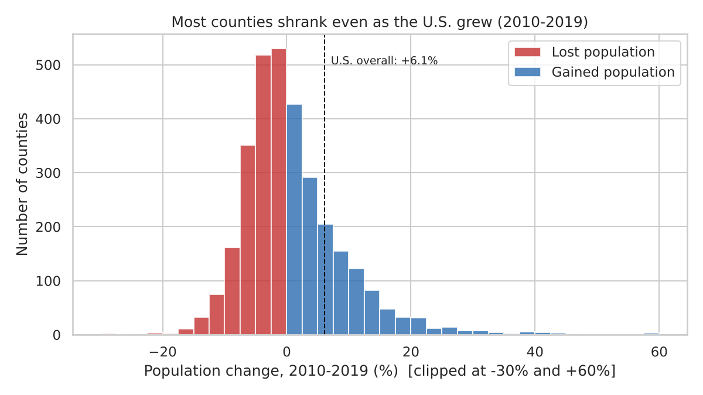
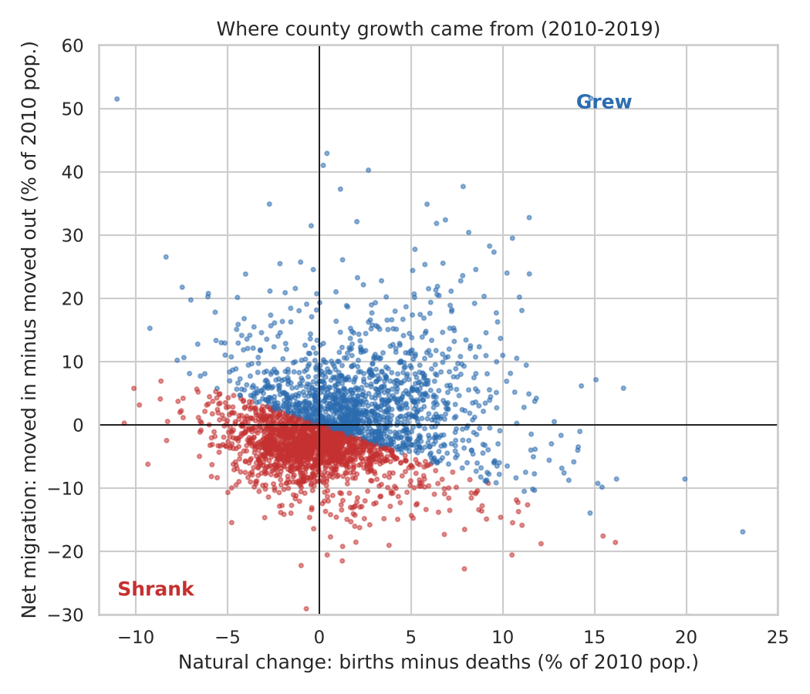
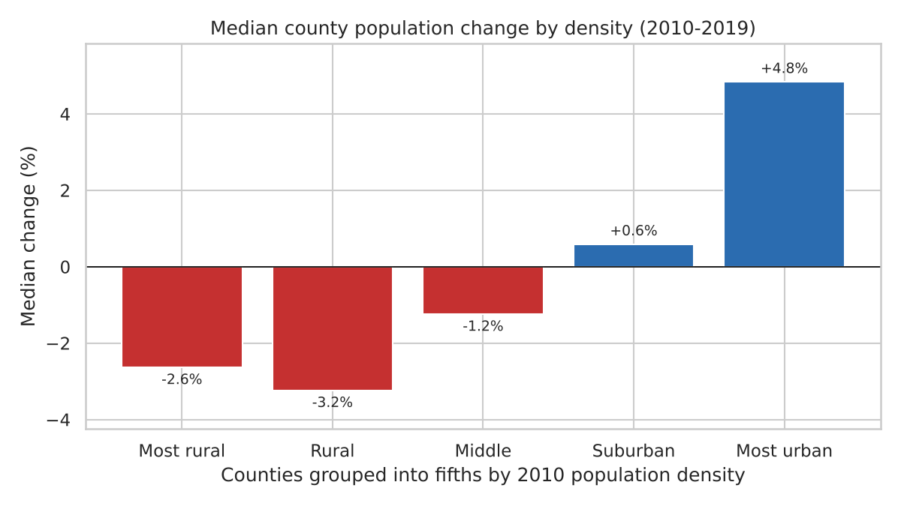
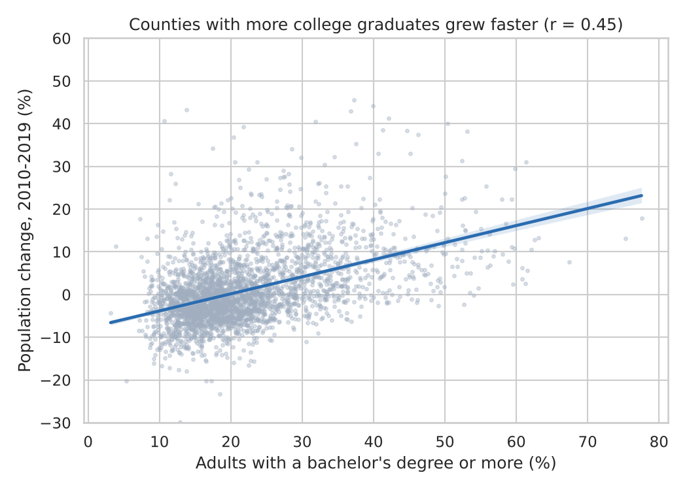
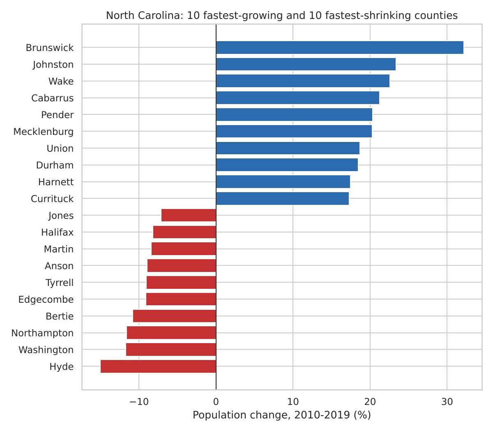

# Where America Grew: U.S. County Population Change, 2010–2019

An exploratory data analysis in Python of population change across 3,142 U.S. counties. It asks why most counties shrank during a decade when the country as a whole grew, and which county traits are linked to faster growth. It ends with a closer look at North Carolina.

**Tools:** Python, pandas, NumPy, SciPy, scikit-learn, Matplotlib, Seaborn



## Questions

1. How evenly was U.S. population growth spread across counties?
2. Was county growth driven more by migration or by births minus deaths?
3. How did growth differ between rural and urban counties?
4. Which county characteristics are linked to faster growth?
5. How does North Carolina compare, and which NC counties grew fastest?

## Key findings

All numbers below are produced by `src/analyze.py` and saved in [`results/summary.md`](results/summary.md).

- **Growth was concentrated.** The U.S. grew 6.1% from 2010 to 2019, yet 54% of counties (1,688 of 3,142) lost population. The 50 counties that added the most people account for 49% of the country's net gain.
- **Migration mattered more than births.** In 68% of counties, net migration moved population more than natural change did. 43% of counties had more deaths than births, and 857 counties lost people both ways.
- **Urban counties grew while rural counties shrank.** Grouping counties into fifths by density, the median county in the most urban group grew 4.8%, while the median county in each of the three least dense groups shrank (−1.2% to −3.2%).
- **Education was the strongest single signal.** The share of adults with a bachelor's degree or more had the strongest correlation with growth (r = 0.45). The share of residents 65 or older was negatively correlated (r = −0.35). A linear regression on four county traits explains about 27% of the variation in growth (5-fold cross-validated R² = 0.27).
- **North Carolina grew faster than the U.S. (9.5% vs. 6.1%), but unevenly.** 44 of its 100 counties lost population, and five Triangle counties (Wake, Durham, Orange, Chatham, Johnston) account for 35% of the state's net gain. Brunswick County grew fastest (+32.2%); Hyde County shrank most (−15.0%).

These are associations, not causes. For example, college-educated workers may move to places that are already growing, rather than education causing growth.

## Charts

| | |
|---|---|
|  |  |
|  |  |

## Data

- `data/raw/county_data_raw.csv`: county-level demographic data (one row per county, plus state and U.S. totals), exported from a workbook used in my UNC coursework. Its columns match the U.S. Department of Agriculture Economic Research Service's *Atlas of Rural and Small-Town America*, which compiles Census Bureau population estimates and American Community Survey data.
- Population change, migration and natural change cover July 2010 to July 2019.
- Education, age and foreign-born shares are survey-based estimates from the same dataset.

## Methods

`src/clean.py`
- Separates county rows from state and U.S. summary rows (FIPS codes ending in `000`).
- Keeps 14 relevant columns and gives them clear names.
- Drops 78 counties with missing key values or zero density, leaving 3,142.
- Adds features: absolute population change, whether a county grew, the main driver of change (migration vs. natural change), log-scaled density, and density quintiles.

`src/analyze.py`
- Summary statistics and group comparisons with pandas.
- Pearson correlations with SciPy.
- A standardized multiple linear regression with scikit-learn, checked with shuffled 5-fold cross-validation. Counties under 1,000 residents are excluded from the model because their percentage changes swing widely.
- Charts with Matplotlib and Seaborn.

## How to run

```bash
pip install -r requirements.txt
python src/clean.py
python src/analyze.py
```

Charts are written to `figures/` and results to `results/` (`summary.md` and `nc_counties_ranked.csv`).

## Project structure

```
us-county-growth/
├── data/
│   ├── raw/county_data_raw.csv
│   └── processed/            # created by clean.py
├── figures/                  # charts created by analyze.py
├── results/                  # summary.md, nc_counties_ranked.csv
├── src/
│   ├── clean.py
│   └── analyze.py
├── requirements.txt
└── README.md
```

## Possible next steps

- Add 2020 Census and post-2020 estimates to see how the pandemic changed migration patterns.
- Map county growth with GeoPandas.
- Compare the Triangle with other fast-growing metro areas.
